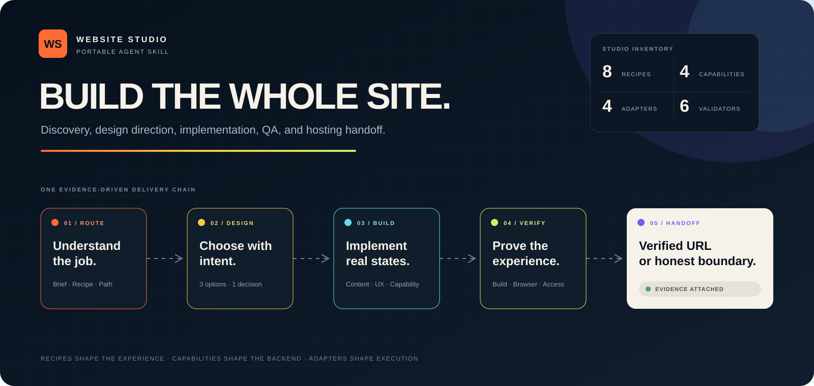
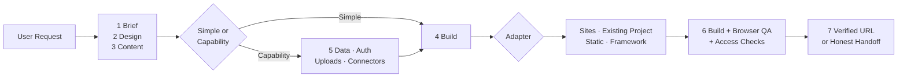
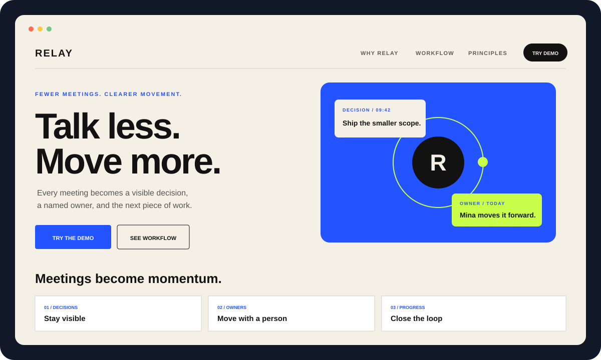
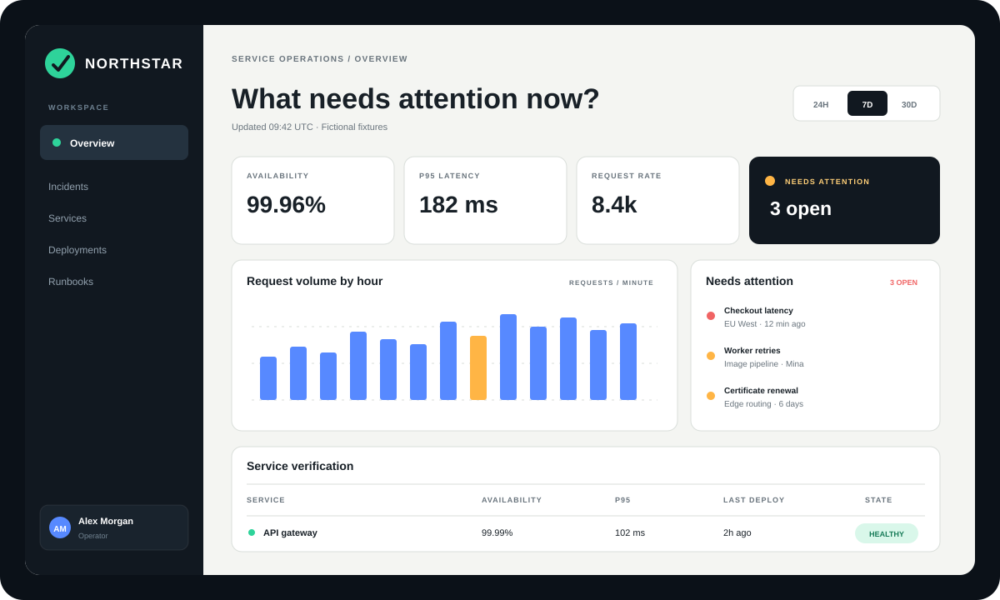
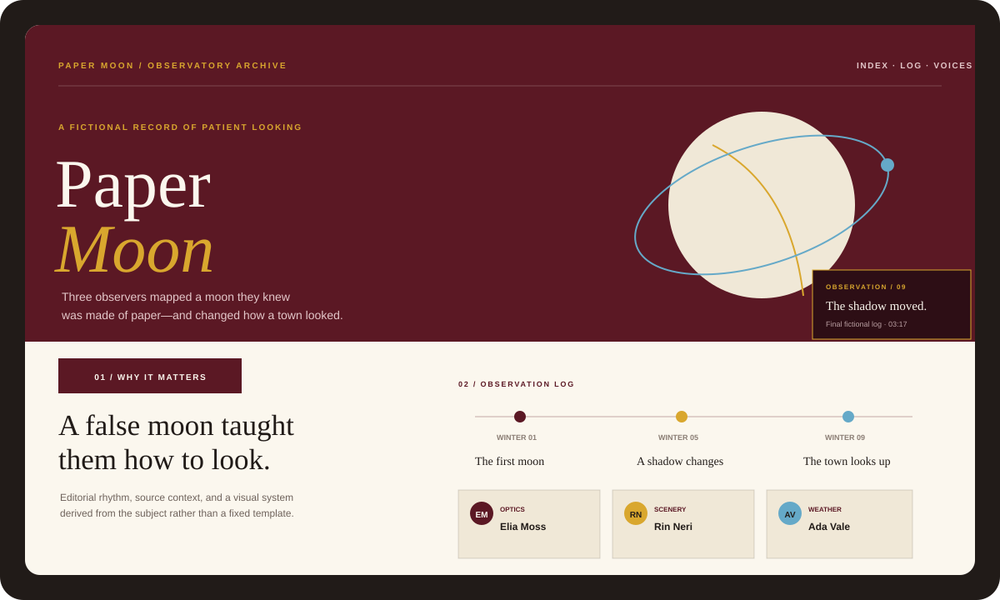

# Website Studio

<p align="center">
  <strong>从一句需求，到一个经过设计、实现、浏览器验收与发布验证的网站。</strong><br />
  <em>A portable Agent Skill for website discovery, design direction, implementation, QA, and hosting handoff.</em>
</p>

<p align="center">
  <a href="https://github.com/Do-fei/website-studio-skill/releases"></a>
  <a href="https://github.com/Do-fei/website-studio-skill/actions/workflows/validate.yml"></a>
  <a href="LICENSE"></a>
  <a href="SKILL.md"></a>
  <a href="package.json"></a>
</p>



`website-studio` 不是页面模板，也不是某个框架的脚手架。它是一套让不同 Agent 在不同工具条件下，都能完整走完建站流程的工作方法：先理解用户任务，再选择网站配方、比较设计方向、完成真实实现，并用可复核证据交付。

**8 类网站配方 · 4 类能力配方 · 4 个执行适配器 · 3 个原创示例 · 6 个确定性验证器**

[开始阅读 Skill](SKILL.md) · [跨 Agent 配置](docs/agent-setup.md) · [查看示例](#examples) · [了解质量门槛](#quality)

## 目录 / Contents

- [为什么需要 Website Studio](#why)
- [适用场景](#archetypes)
- [七阶段工作流](#workflow)
- [运行架构](#architecture)
- [快速开始](#quick-start)
- [跨 Agent 使用](#cross-agent)
- [原创示例](#examples)
- [质量门槛与验证](#quality)
- [包结构](#package-map)
- [能力边界与免责声明](#boundaries)

<a id="why"></a>
## 为什么需要 Website Studio / Why Website Studio

很多 Agent 能生成一个漂亮首屏，却容易漏掉真实内容、错误状态、移动端、键盘操作、部署路径或公开访问验证。Website Studio 约束的不是一种审美，而是一条完整交付链。

| 原则 | Website Studio 的约束 |
| --- | --- |
| **先判断，再构建** | 先选择网站配方、Simple path 或 Capability path，再决定架构。 |
| **把设计变成可见决策** | 高影响视觉选择使用同一内容和视口比较三个真正不同的方向。 |
| **不假装拥有能力** | 没有浏览器、数据库、连接器或部署权限时明确降级，不虚构结果。 |
| **用证据结束任务** | 构建成功、视觉正确和已经上线是三种不同证据，不能互相替代。 |

它不会让所有网站长得一样。相反，它要求视觉系统从产品任务、主题、受众和内容本身生长，并拒绝没有理由的通用渐变、万能卡片和装饰性界面。

<a id="archetypes"></a>
## 适用场景 / Website Archetypes

每个项目选择一个主配方，最多加入一个辅助配方。不要为了显得“功能很多”而把所有模块混成一个万能页面。

| 配方 | 访客主要任务 | 常见项目 |
| --- | --- | --- |
| [Landing Page](recipes/landing-page.md) | 理解价值并采取行动 | 产品发布、活动、营销页 |
| [Portfolio](recipes/portfolio.md) | 判断能力与合作价值 | 个人、工作室、案例集 |
| [Editorial Story](recipes/editorial-story.md) | 跟随叙事理解主题 | 专题、档案、纪念站 |
| [Knowledge Hub](recipes/knowledge-hub.md) | 快速找到可信答案 | 文档、学习中心、资源库 |
| [Directory / Catalog](recipes/directory-catalog.md) | 搜索、筛选和比较条目 | 图鉴、产品目录、资源目录 |
| [Dashboard](recipes/dashboard.md) | 理解状态并调查变化 | 指标、运营、监控 |
| [Portal / Internal Tool](recipes/portal-internal-tool.md) | 完成角色相关任务 | 运营后台、客户门户 |
| [Tracker / Workflow](recipes/tracker-workflow.md) | 创建记录并推动状态 | 看板、审批、任务流 |

### 两条执行路径

- **Simple path**：适合内容型、一到少量页面、轻交互且不需要持久数据、登录、上传或外部连接器的网站。
- **Capability path**：适合数据库、身份、上传、外部数据、写操作、私有内容和复杂工作流。

两条路径的区别是架构复杂度，不是质量等级。两者都必须完成响应式、无障碍、真实构建和视觉验收。

<a id="workflow"></a>
## 七阶段工作流 / Seven-Gate Workflow

| 阶段 | Agent 要完成的工作 | 留下的证据 |
| --- | --- | --- |
| **1. Brief** | 补齐受众、用户任务、内容、能力和发布边界 | 网站 Brief 与假设 |
| **2. Design Direction** | 从主题和产品任务生成视觉系统；必要时比较三个方案 | 设计决定与 tokens |
| **3. Content & Product Shape** | 定义路由、层级、流程和正常／空／加载／错误／权限状态 | 路由与状态矩阵 |
| **4. Build** | 完成语义结构、真实内容、响应式、键盘与触控实现 | 可运行实现与生产构建 |
| **5. Capabilities** | 按需加入数据、认证、上传或连接器 | 能力矩阵与安全边界 |
| **6. Verify** | 运行确定性检查，检查桌面、平板、手机和关键流程 | 构建、截图和交互证据 |
| **7. Publish & Handoff** | 发布精确验证版本，或诚实交付待部署产物 | 已验证网址或部署清单 |

当一个高影响设计决策尚未明确时，Agent 会比较**恰好三个**使用相同内容、视口和媒介的方案；最多进行四轮连续选择。用户已经给足方向或授权 Agent 决定时，流程会直接推进，不制造无意义的选择题。

<a id="architecture"></a>
## 运行架构 / Architecture



**Recipe** 决定“做什么体验”，**Capability** 决定“需要什么后端能力”，**Adapter** 决定“在当前 Agent 和项目条件下如何实现”。

<a id="quick-start"></a>
## 快速开始 / Quick Start

### 1. 获取完整 Skill

```bash
git clone https://github.com/Do-fei/website-studio-skill.git website-studio
```

也可以从 [Releases](https://github.com/Do-fei/website-studio-skill/releases) 下载归档。请保留整个目录结构，并确保最终 Skill 目录名是 `website-studio`；Agent 会从 `SKILL.md` 开始，再按需加载 recipe、reference 和 adapter。

### 2. 安装或提供给 Agent

将完整文件夹放入 Agent 支持的 Skills 目录。不同 Agent 的目录、发现方式和项目规则不同；不支持原生 Skills 时，可以把本仓库作为项目资料提供。

[查看完整的跨 Agent 安装与调用指南 →](docs/agent-setup.md)

### 3. 发起第一个任务

```text
使用 website-studio，为我的产品制作一个完整官网。

请先判断：
1. 主网站配方；
2. Simple path 还是 Capability path；
3. 当前 Agent 可用的浏览器、数据和部署能力。

完成设计、实现、桌面与手机验收，并先交付私有预览；
未经我确认不要公开发布。
```

Skill 本身没有运行时依赖；附带的确定性验证器需要 **Node.js 20+**，且不依赖第三方 npm 包。

<a id="cross-agent"></a>
## 跨 Agent 使用 / Cross-Agent Usage

| Agent 环境 | 使用方式摘要 | 预期边界 |
| --- | --- | --- |
| 原生支持 Agent Skills | 安装完整目录，由描述自动或显式触发 | 可按需加载文件 |
| 支持仓库／项目规则 | 将本包保留在项目上下文并指向 `SKILL.md` | 需要显式约束加载顺序 |
| 仅支持文件或会话上下文 | 提供完整归档并要求保留目录关系 | 可能需要每次手动触发 |
| 缺少浏览器或部署能力 | 继续构建与确定性检查 | 必须声明未完成的视觉或上线证据 |

Website Studio 的可移植性来自能力路由和诚实降级，不是因为它假设所有 Agent 都拥有相同工具。

**[查看各类 Agent 的安装、触发和上下文配置 →](docs/agent-setup.md)**

<a id="examples"></a>
## 原创示例 / Examples

三个示例均使用原创布局与虚构内容，用来展示方法，不是要求复制的固定主题。下方图片是为 README 制作的原创矢量预览；可运行示例保存在对应目录。

| Launch Site | Dashboard | Editorial Story |
| --- | --- | --- |
| [](examples/launch-site/) | [](examples/dashboard/) | [](examples/editorial-story/) |
| **Landing Page · Simple path**<br />价值层级、CTA、证据和移动端节奏 | **Dashboard · State-rich UI**<br />指标层级、图表、表格及成功／加载／空／错误状态 | **Editorial Story · Narrative system**<br />长页叙事、图像节奏、来源和媒体边界 |

每个示例都带有自己的 `site-quality.config.json`，可用于理解路由、关键文本、资源、视口和访问模型如何进入验证流程。

<a id="quality"></a>
## 质量门槛与验证 / Quality & QA

> **“构建成功”“视觉正确”“已经上线并可访问”是三种不同证据。Website Studio 不允许它们互相替代。**

| 证据层 | 证明什么 | 主要方法 |
| --- | --- | --- |
| **Package** | Skill 目录、引用、配方和示例完整 | 包验证与测试 |
| **Build** | 项目能够生成真实生产产物 | 项目构建、类型与测试 |
| **Browser** | 层级、裁切、响应式、键盘和关键状态正确 | 桌面／平板／390 px／320 px 检查 |
| **Deployment** | 最终网址、资源路径和访问模型符合预期 | 匿名或受保护访问验证 |

### 验证本包

```bash
npm test
```

### 验证一个网站项目

```bash
node scripts/inspect-project.mjs /path/to/project
node scripts/validate-config.mjs /path/to/site-quality.config.json
node scripts/validate-export.mjs --config /path/to/site-quality.config.json
node scripts/audit-media.mjs --manifest /path/to/media-manifest.json --release-mode public
node scripts/validate-deployment.mjs https://example.com/ --config /path/to/site-quality.config.json
```

| 工具 | 负责发现的问题 |
| --- | --- |
| [`inspect-project.mjs`](scripts/inspect-project.mjs) | 现有技术栈、脚本、托管与能力线索 |
| [`validate-config.mjs`](scripts/validate-config.mjs) | 路由、状态、视口、访问模式和资源契约 |
| [`validate-export.mjs`](scripts/validate-export.mjs) | 静态／SPA 导出、路径、必需文本和资源 |
| [`audit-media.mjs`](scripts/audit-media.mjs) | 第三方媒体状态、来源、许可和发布阻断项 |
| [`validate-deployment.mjs`](scripts/validate-deployment.mjs) | 已部署路由、资源、内容类型和匿名访问 |
| [`validate-package.mjs`](scripts/validate-package.mjs) | Skill 自身的结构、链接、模板和示例完整性 |

自动验证不能替代浏览器检查。视觉层级、首屏理解、图片焦点、文字换行、触控、键盘、文本缩放、降低动态效果以及动态错误状态，仍需要真实页面证据。

<a id="package-map"></a>
## 包结构 / Package Map

```text
website-studio/
├── SKILL.md          # 七阶段主工作流
├── references/       # 发现、设计、内容、实现、安全、QA 与发布规则
├── recipes/          # 8 类网站配方 + 4 类能力配方
├── adapters/         # Sites、现有项目、静态、通用框架
├── assets/           # Brief、矩阵、tokens 与中性页面 shell
├── scripts/          # 确定性检查工具
├── examples/         # 3 个原创、可运行示例
├── tests/            # 路由与验证器测试
├── THIRD_PARTY.md    # 第三方内容与责任边界
└── LICENSE           # MIT
```

| 目录 | 什么时候读取 |
| --- | --- |
| [`SKILL.md`](SKILL.md) | 每次建站任务的入口 |
| [`references/`](references/) | 进入对应工作阶段时 |
| [`recipes/`](recipes/) | 选择一个主网站配方，并按需加载能力配方 |
| [`adapters/`](adapters/) | 确定当前项目与可用平台后 |
| [`assets/`](assets/) | 需要 Brief、矩阵、tokens 或中性起步结构时 |
| [`scripts/`](scripts/) | 构建前后进行确定性检查时 |
| [`examples/`](examples/) | 需要理解实现质量而不是复制主题时 |

Agent 不需要一次读完所有文件：先读 `SKILL.md`，再加载一个网站配方、必要能力配方和一个执行适配器。

<a id="boundaries"></a>
## 能力边界与免责声明 / Boundaries & Disclaimer

- Website Studio 不是托管服务、数据库、身份提供商、连接器或浏览器。
- Skill 不会自动获得账号、凭据、外部写入权限或公开发布授权。
- 没有浏览器时可以完成构建与静态检查，但不能声称完成真实视觉验收。
- 没有部署工具或权限时，应交付已验证产物和部署清单，不能虚构网址。
- 安全、隐私、来源和版权说明属于工程工作流，不替代专业法律或安全审计。
- 公开可见、可搜索或非商业使用，不等于获得复制、修改或再分发许可。
- 本仓库的原创说明、模板、示例和代码使用 [MIT License](LICENSE)；用户项目中的品牌、数据、媒体和第三方依赖继续受各自条款约束。
- 详细的第三方内容边界见 [`THIRD_PARTY.md`](THIRD_PARTY.md)。

Website Studio 的目标不是让每个网站看起来一样，而是让不同 Agent 都能以同样诚实、完整和可验证的方式把网站做好。

---

**[从 `SKILL.md` 开始](SKILL.md)** · **[下载最新 Release](https://github.com/Do-fei/website-studio-skill/releases/latest)** · **[跨 Agent 配置](docs/agent-setup.md)** · **[故障排查](docs/troubleshooting.md)**
